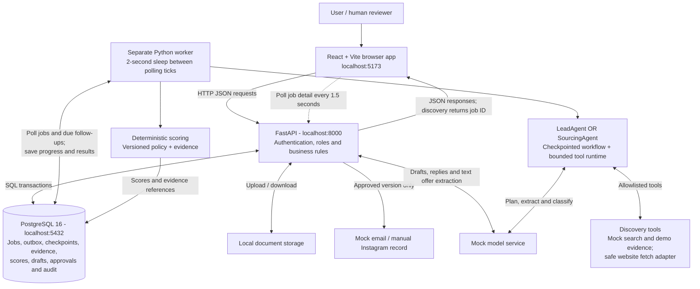

# System architecture and request flow

Checked against the project source on 19 October 2026. Current local mode uses React/Vite, FastAPI, PostgreSQL 16, a separate worker, local documents, mock AI/search/email and manual Instagram recording.

View the [architecture image](diagrams/system-architecture.svg), [PNG export](diagrams/system-architecture.png), or editable Mermaid sources for [components](diagrams/system-architecture.mmd), [discovery](diagrams/discovery-request-flow.mmd) and [outreach](diagrams/outreach-request-flow.mmd).

## Current local architecture



The agents are configurations sharing one workflow and runtime, rather than separate deployed services. **LeadAgent finds buyers; SourcingAgent finds suppliers.** The selected objective is explicit and validated. PostgreSQL owns business state, checkpoints, approvals and audit. The model supplies research plans and structured outputs; backend code owns authorization, scoring and workflow mutations.

In local queue mode, the worker polls database jobs directly and marks pending outbox records published. No local SQS, Redis or in-memory broker sits between PostgreSQL and the worker. The worker sleeps two seconds after a tick; processing time adds to that interval. Browser progress uses HTTP polling.

## Discovery request flow

```mermaid
sequenceDiagram
    autonumber
    actor User
    participant UI as React browser
    participant API as FastAPI
    participant DB as PostgreSQL
    participant W as Worker
    participant R as Selected agent + runtime
    participant M as Model service
    participant T as Discovery tools
    User->>UI: Select buyers/suppliers and submit query
    UI->>API: POST /api/jobs + agent_type + Idempotency-Key
    API->>API: Validate input and authorize selected objective
    API->>DB: Create job, steps, outbox and audit in one request transaction
    API-->>UI: 201 Created + job ID + QUEUED
    W->>DB: Publish pending outbox; poll runnable jobs
    W->>DB: Acquire per-job advisory lock; mark RUNNING
    loop For each incomplete research step
        W->>R: Execute step for selected objective
        R->>M: Plan / structured extraction / classification as needed
        M-->>R: Validated structured output
        opt Runtime requests an allowed tool
            R->>T: Bounded call with timeout and deduplication
            T-->>R: Evidence or explicit unavailable status
        end
        R-->>W: Structured result and source references
        W->>DB: Commit checkpoint, heartbeat and audit
    end
    W->>DB: Deduplicate candidates; save deterministic scores
    W->>DB: Set final job status; release advisory lock
    loop Concurrent UI polling while job is not terminal
        UI->>API: GET /api/jobs/{job_id} every 1.5 seconds
        API->>DB: Read status, steps and candidates
        DB-->>API: Persisted progress and results
        API-->>UI: JSON response
    end
    UI-->>User: Evidence and scores ready for review
```

Model/tool interactions are conditional: some steps inspect collected evidence or run deterministic code. Candidate persistence and scoring occur within their checkpointed steps; the final two worker messages summarize those effects. Polling happens concurrently with processing. A partial source result is recorded explicitly. After restart, completed steps are skipped; failures become retryable or permanent according to the attempt limit. The API returns before background discovery finishes.

## Review, draft and outreach flow

```mermaid
sequenceDiagram
    autonumber
    actor User as Human reviewer
    participant UI as React browser
    participant API as FastAPI business services
    participant DB as PostgreSQL
    participant M as Model service
    participant P as Mock email / manual record
    User->>UI: Review candidate and approve outreach eligibility
    UI->>API: POST /api/candidates/{id}/review
    API->>DB: Authorize reviewer; save review and audit
    UI->>API: POST /api/candidates/{id}/drafts
    API->>DB: Read candidate and evidence; check eligibility
    API->>M: Generate draft for selected objective
    M-->>API: Structured draft and evidence IDs
    API->>DB: Validate references; save draft version and audit
    API-->>UI: Return draft for editing
    opt Reviewer edits draft
        UI->>API: PATCH /api/drafts/{draft_id}
        API->>DB: Increment version; invalidate previous approval
    end
    User->>UI: Approve current version
    UI->>API: POST /api/drafts/{draft_id}/approve
    API->>DB: Store approval for exact draft version
    User->>UI: Send simulated email / record manual Instagram send
    UI->>API: POST /api/drafts/{draft_id}/send or /record-manual-send
    API->>DB: Lock records; recheck role, approval, version and contact rules
    API->>P: Simulate email or record manual action
    P-->>API: Stable provider reference
    API->>DB: Save message, thread state and audit; commit
    API-->>UI: Recorded result
```

Draft generation runs synchronously in the API request. Mock email makes no external email call; the Instagram endpoint records an action performed manually. The worker checks due local follow-ups and generates drafts requiring review. Documents pass through the API to local storage; metadata and offer extraction are stored in PostgreSQL. PDF/Office files receive metadata-only handling, while TXT/CSV may be passed to the model for offer extraction.

## AWS component mapping

These are configured adapters and Terraform definitions, not a claim that this application has been deployed. Existing AWS auction infrastructure is a separate system.

| Local component | Optional AWS deployment counterpart |
|---|---|
| Vite serves React | Private frontend S3 bucket through CloudFront |
| Local identity | Cognito authorization-code flow with PKCE; API validates access tokens and roles |
| FastAPI process | HTTPS ALB to private ECS Fargate API tasks |
| Local PostgreSQL | Private RDS PostgreSQL 16; API/worker connect directly |
| Local worker and database job polling | ECS Fargate worker publishes transactional outbox and consumes SQS |
| Mock model | Configurable Bedrock Converse adapter |
| Local documents | Private S3 documents through API |
| Local due-follow-up polling | EventBridge Scheduler sends work to SQS |
| Local logs | CloudWatch logs and alarms |

In SQS mode, the worker publishes committed outbox records before consuming messages, extends visibility during processing and acknowledges completed work. Database idempotency/checkpoints protect repeated deliveries; failed deliveries may reach the configured dead-letter queue. Browser API requests go directly to the ALB API origin; the current CloudFront definition serves frontend assets only. AWS configuration does not enable real email delivery.

## Source references

- `frontend/src/api.ts`, `frontend/src/pages.tsx`: HTTP requests and polling intervals.
- `backend/app/api/routes.py`, `backend/app/database/__init__.py`: routes and transaction boundaries.
- `backend/app/workflow/discovery.py`, `backend/app/agents/shared/runtime.py`: checkpoints, locks and bounded tools.
- `worker/app/main.py`, `backend/app/integrations/queue.py`: polling, outbox, SQS and follow-ups.
- `backend/app/services/business.py`, `backend/app/scoring/__init__.py`: approvals, simulated sending and scoring.
- `infra/modules/platform`, `infra/modules/foundation`: AWS mapping.
